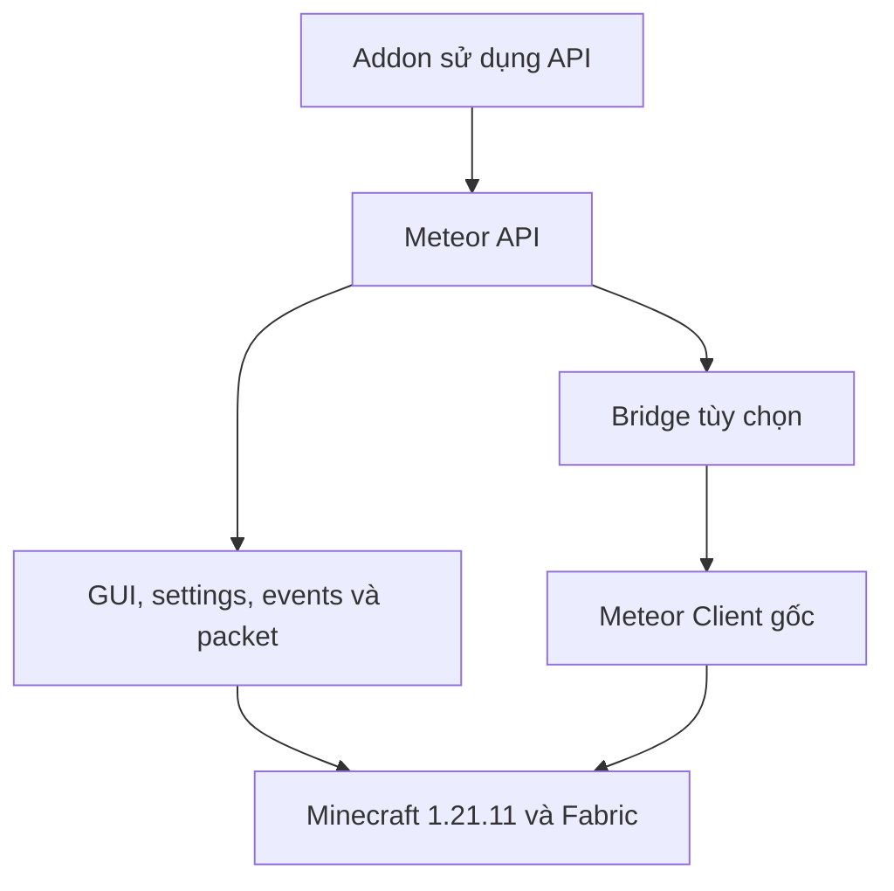

# Phân biệt Meteor API và Meteor Client

| Thuộc tính | Meteor API 0.1.2-beta | Meteor Client gốc |
|---|---|---|
| Định danh | `meteor-api` | `meteor-client` |
| Package chính | `dev.meteorapi.*` | `meteordevelopment.meteorclient.*` |
| Vai trò | Thư viện GUI, settings, sự kiện và mạng | Client và hệ thống module/HUD/GUI gốc |
| Cài riêng | Có | Có |
| Cài cùng nhau | Có, API không nhúng lại Meteor | Dùng bản 1.21.11 build 86 cho bridge đã kiểm tra compile |
| Điểm truy cập | `MeteorApi` | API gốc hoặc `MeteorClientApi` khi có bridge |
| Cấu hình | `config/meteor-api/settings.properties` | Thư mục config/NBT Meteor gốc |
| Phím mặc định | F8 | Phím của Meteor, giữ nguyên |

Mã của Meteor Client không được relocate hay nhúng lại vào JAR API. Vì vậy không có
hai bản singleton `Modules`, event bus hay class Meteor cùng FQCN trong hai mod.
Các class `compat`/`compat26` chỉ được dùng khi dependency tương ứng hiện diện.
Entry point `meteor` do Meteor nạp; entry point `modmenu` do Mod Menu nạp. Fabric
chỉ nạp client initializer lõi, không khởi tạo hai optional class đó khi thiếu dependency.

Foundation là Java thuần. API dùng Minecraft và bốn Fabric API submodule đã ghim.
Metadata của các submodule yêu cầu Loader >=0.17.3, phù hợp Loader 0.19.5. Điều
này được kiểm tra từ artifact thực tế, không thay số Loader trong một binary không tương thích.

Bridge đăng ký widget factory bằng class mới thuộc `dev.meteorapi.compat26` để tránh
ghi đè factory của setting gốc. Không tự đăng ký module thời tiết/demo vào Meteor.
Caller chọn dùng `AddonRegistry` và đọc `RegistrationResult` để quản lý module của mình.

## Rút gọn nhưng vẫn có đường truy cập đầy đủ

`Panels` và `Canvas` rút gọn các trường hợp thường gặp, đồng thời giữ Screen và
DrawContext gốc. Payloads giữ codec và phân biệt phase/direction; API Fabric vẫn
có thể dùng trực tiếp. `MeteorClientApi` trả nguyên hệ thống Modules, HUD, theme,
commands, event bus của Meteor; không sao chép registry sang một instance giả.

Lớp bảo vệ chỉ áp dụng khi addon dùng đường đăng ký mới. Addon khác gọi trực tiếp
API legacy hoặc thay đổi registry bên ngoài vẫn có thể tự tạo xung đột.
