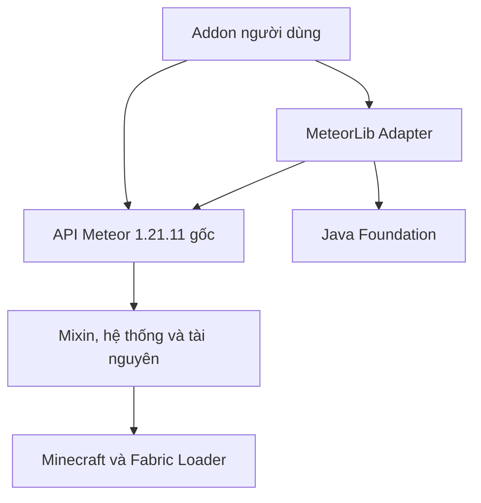

# Phân tách API và runtime

Nền tảng hoạt động là Minecraft 1.21.11, Yarn `1.21.11+build.3`, Java 21,
Fabric Loader 0.19.5, Meteor build 86. Chỉ phần này được biên dịch vào các JAR phát hành.

## Các tầng

| Tầng | Phụ thuộc | Đầu ra |
|---|---|---|
| Foundation | Java 21 | `meteor-lib-foundation` |
| Adapter | Foundation, Meteor API, Minecraft, Fabric Loader, Orbit | `meteor-lib-api` |
| Runtime tương thích | Toàn bộ Meteor build 86 và các phụ thuộc upstream | `meteor-lib-runtime` |
| Addon ví dụ | Adapter và API Meteor | `meteor-lib-example` |

Một bản chỉ có stub hoặc interface sẽ không thể bảo toàn hành vi: mixin phát event,
GUI và settings gọi renderer, các utility đọc singleton hệ thống, nhiều mixin truy vấn
trực tiếp module có sẵn. Vì vậy runtime giữ toàn bộ lớp gốc; phân tách hiện tại là theo
thành phần, phụ thuộc và namespace, không tùy tiện cắt bỏ lớp đang được tham chiếu.

## Những nhóm API cần giữ

| Nhóm | Điểm vào và trách nhiệm |
|---|---|
| Khởi động | `MeteorClient`, `PreInit`, `PostInit`, `ReflectInit` |
| Addon | `MeteorAddon`, `AddonManager`, metadata `meteor` |
| Event | `MeteorClient.EVENT_BUS`, Orbit, các lớp `events.*` |
| Modules | `Modules`, `Module`, `Category`, `Categories` |
| Settings | `Setting<T>`, `Settings`, `SettingGroup`, các Builder |
| Commands | `Command`, `Commands`, Brigadier và argument types |
| HUD | `Hud`, `HudElement`, `HudElementInfo`, `HudRenderer` |
| GUI | `GuiTheme`, `GuiThemes`, screens, widgets, tabs |
| Rendering | `renderer.*`, utility render, colors, mesh, texture, fonts |
| Hệ thống lưu trữ | `System`, `Systems`, config, profiles, friends, waypoints, macros, accounts, proxies |
| Player/world/entity | Utility thao tác game, block, inventory, rotation và truy vấn thế giới |
| Network | Event packet, HTTP và proxy, online players |
| Scripting/pathing | Starscript, path manager, bridge Baritone tùy chọn |
| Tích hợp game | Accessor mixin, mixin interfaces, access widener, mixin plugin/ASM |
| Tài nguyên/build | Shader, font, atlas, bản dịch, icon, launcher và các JAR lồng |

Danh mục máy đọc chia thành 34 nhóm theo package, xem
`generated/1.21.11-components.json` và `generated/1.21.11-API-INDEX.md`.
Số nhóm là cách phân loại phục vụ phân tích, không phải 34 JAR có thể nạp độc lập.

## Phần bổ sung

`dev.meteorlib.foundation.*` không có import Minecraft hoặc Meteor. `ResourceScope`
quản lý cleanup theo thứ tự ngược; `Registration` đóng một lần; `TickScheduler` giới hạn
hàng đợi và số tác vụ mỗi tick; `ServiceRegistry` kiểm tra kiểu; `NameRules` và
`RegistrationResult` dùng chung cho đăng ký an toàn.

`dev.meteorlib.api.*` là lớp tiện ích có thể chọn dùng. Truy cập toàn bộ API gốc bằng
import gốc luôn được hỗ trợ. Không tạo hàng nghìn wrapper không cần thiết cho cùng lớp.

## Tương thích định danh

Runtime giữ `id=meteor-client`, phiên bản gốc `1.21.11-86` vì `MeteorClient.MOD_META`,
addon dependency và nhiều đường dẫn resource dùng định danh đó. Tên hiển thị chỉ rõ
MeteorLib; `provides=meteor-lib-runtime` cung cấp định danh bổ sung. Adapter có
`id=meteor-lib-api`, namespace Java riêng `dev.meteorlib.*`.

Cài runtime và Meteor gốc cùng lúc tạo hai mod có cùng id; chọn một trong hai cách
cài ở README. Đây là ràng buộc để giữ tương thích, không che giấu runtime Meteor.
